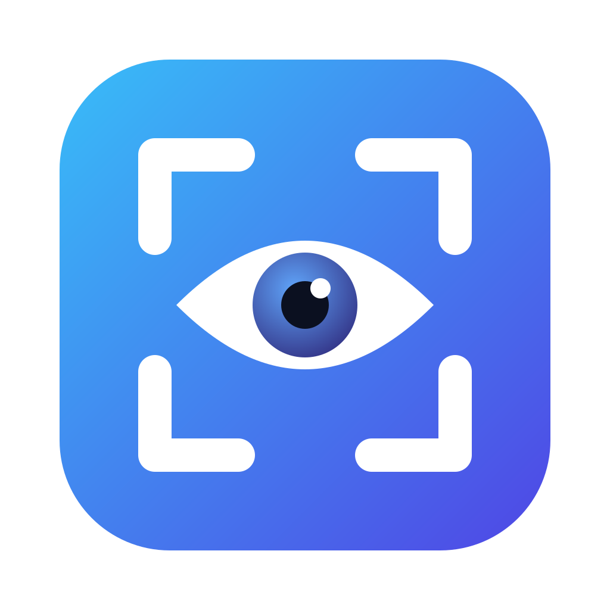

<p align="center">
  
</p>

<h1 align="center">Clumsee</h1>

<p align="center">
  Pilih area layar, lalu tanya AI, salin teksnya, scan QR, atau cari di Google.<br />
  Aplikasi desktop untuk macOS, Windows, dan Linux.
</p>

---

## Fitur

- **Capture area layar dengan hotkey.** Tekan `Cmd/Ctrl + Shift + X`, layar menyala dengan glow warna tema, lalu seret untuk memilih area.
- **Tanya AI tentang area itu.** Mendukung Gemini, Claude, dan OpenAI. Jawaban muncul di sidebar melayang di kanan layar, bisa ditanya lanjutan, dan ada *mode pintar* untuk model yang lebih kuat.
- **Blok dan salin teks dari layar.** Teks di area pilihan dibaca dengan OCR lokal (Tesseract), lalu bisa diblok dengan mouse dan dicopy pakai `Cmd/Ctrl + C`. Prosesnya cepat, offline, dan tanpa token.
- **Cari di Google.** Teks yang diblok, atau semua teks di area, langsung dibuka sebagai pencarian Google.
- **Scan QR code dan barcode.** Kalau isinya link, klik untuk membuka di browser. Kalau bukan link, isinya bisa dicopy.
- **Mode Tanpa AI.** Pakai Clumsee hanya untuk OCR, scan QR/barcode, dan pencarian Google. Tidak perlu API key.
- **Tampilan rumus dan kode.** Rumus LaTeX ditampilkan rapi dengan KaTeX, dan blok kode diberi warna sintaks plus tombol Copy.
- **Warna tema per provider.** Defaultnya Gemini biru, Claude oranye, dan OpenAI hijau. Bisa diganti di Settings.
- **Riwayat dan pemakaian.** Percakapan tersimpan dan bisa dicari. Ada catatan token dan biaya, serta batas harian token atau USD.

## Privasi

- Gambar **hanya dikirim ke AI setelah kamu menekan Send**, dan hanya ke provider yang kamu pilih.
- OCR, scan QR, dan pencarian Google berjalan **di komputer kamu**. Gambar tidak dikirim ke mana pun.
- API key disimpan terenkripsi lewat keychain sistem (Keychain, DPAPI, atau libsecret).
- Jendela capture dan sidebar disembunyikan dari screenshot dan screen share.
- Thumbnail di riwayat bisa dimatikan di Settings.

## Instalasi (development)

Kebutuhan: **Node.js 23.6+**, karena test memakai TypeScript langsung lewat `node --test`.

```bash
npm install
npm run dev
```

Saat pertama dibuka, Clumsee menampilkan langkah setup: pilih provider (atau *Tanpa AI*), isi API key, lalu atur hotkey. Setelah itu app berjalan di tray atau menu bar.

### Izin macOS

macOS membutuhkan izin **Screen Recording**: buka *System Settings → Privacy & Security → Screen Recording*, aktifkan Clumsee, lalu restart app.

### API key

| Provider | Ambil key di |
| --- | --- |
| Gemini | https://aistudio.google.com/apikey |
| Claude | https://platform.claude.com/settings/keys |
| OpenAI | https://platform.openai.com/api-keys |

## Build

```bash
npm run dist:mac     # .dmg (arm64 + x64)
npm run dist:win     # installer NSIS (x64)
npm run dist:linux   # AppImage + .deb (x64)
```

Hasil build ada di folder `dist/`. Build macOS belum ditandatangani, jadi buka pertama kali dengan *klik kanan → Open*.

## Script lain

```bash
npm run typecheck   # cek tipe TypeScript
npm test            # unit test
```

## Struktur project

```
src/
  shared.ts              tipe & konstanta untuk main, preload, dan renderer
  main/                  proses utama Electron
    index.ts             window, hotkey, IPC, alur capture → sidebar
    capture.ts           ambil screenshot & crop
    ocr.ts               OCR lokal (Tesseract)
    providers/           Gemini, Claude, OpenAI
    store/               settings, API key terenkripsi, riwayat (SQLite)
  preload/               API aman untuk renderer
  renderer/
    overlay/             layar capture: seleksi, OCR, QR, lalu jadi sidebar
    panel/               komponen sidebar jawaban (markdown, rumus, kode)
    dashboard/           riwayat, pemakaian, settings, onboarding
resources/               logo (icon.svg / icon.png)
```

## Dibangun dengan

Electron · React · TypeScript · Tailwind CSS · electron-vite · Tesseract.js · jsQR · KaTeX · highlight.js

## Pembuat

Adam ([adamwahyu875@gmail.com](mailto:adamwahyu875@gmail.com))
